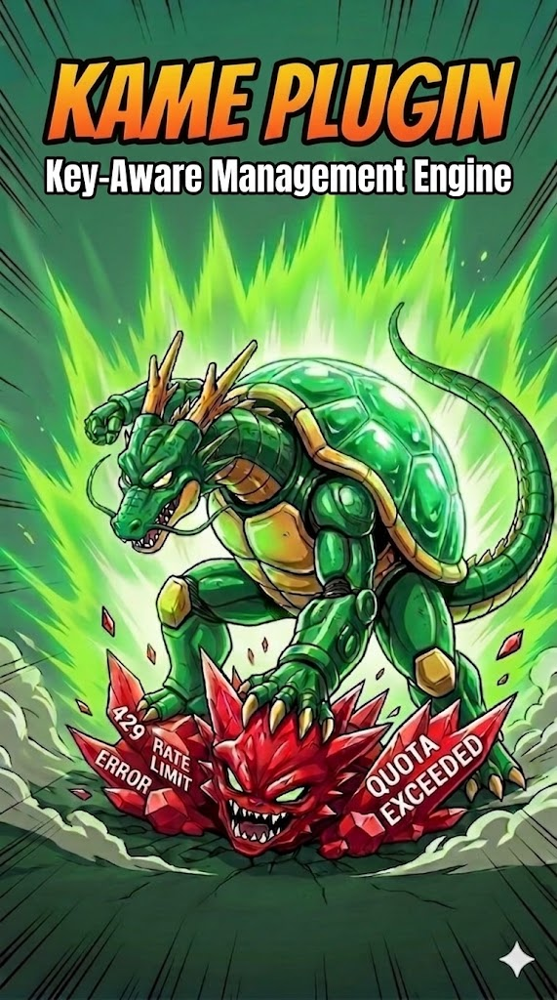
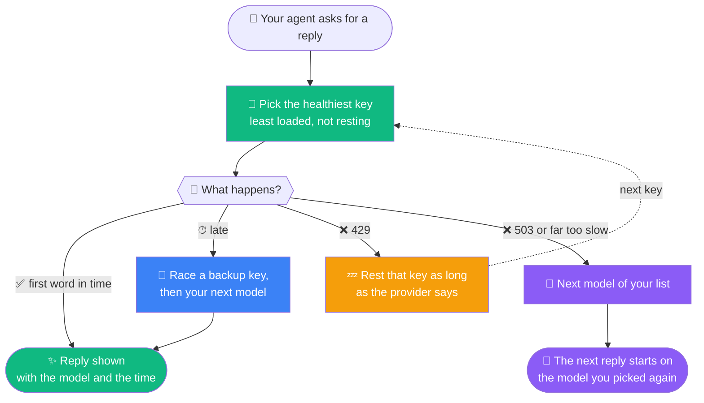

<div align="center">



# 🐢⚡ KAME — the best free API key rotation for AI agents

### Join the quota of many API keys, projects and accounts into one — and never let a 429 stop your agent again.

[](https://github.com/Kame696/kame-api-rotation-for-agent-zero)
[](https://github.com/Kame696/kame-api-rotation-for-hermes)
[](#-pick-your-agent)
[](#-faq)
[](#-license)

**Free · MIT · no proxy · no account · no telemetry · works with any provider**

</div>

---

## 🤔 What is KAME, in 20 seconds?

You have several API keys — one Gemini free-tier key per Google project, keys on OpenRouter,
Groq, NVIDIA, Mistral, OpenAI, Anthropic… Your AI agent uses **one** of them. When it hits
`429 Too Many Requests`, `RESOURCE_EXHAUSTED`, a daily quota or an "overloaded" provider,
**your agent stops** — while every other key sits there unused.

**KAME turns all your keys and models into one big pool.** Your agent keeps working, faster,
on more quota than any single key has.

### Two jobs in one plugin — most key rotators only do the first

<table>
<tr>
<td width="50%" valign="top">

### 🔁 Rotation — more quota
All your keys, projects and accounts become **one pool** (14 Gemini projects = 14× the free quota). A `429`, a daily quota or a dead key moves the call to the **next healthy key at once**, and the refused key rests **exactly as long as the provider says**.

</td>
<td width="50%" valign="top">

### ⚡ Racing — less waiting
A reply that is **late**, **stops mid-thought** or **goes silent half-way** is sent again to another key or your **next model**. The first to answer is shown, the rest is cut. Extra requests only when a reply is stuck.

</td>
</tr>
</table>

Also: 🔀 **your model leads** — every reply starts on the model you picked; your fallback list takes over only when it is busy, spent or slow · 🧠 **reads every error** — 82 providers learned from their own docs · 👀 **you see everything** — which model answered each reply, and how long it took.

## ⚡ How fast is it?

Measured live, on the author's own Gemini free-tier keys (four models × 14 keys), November 2026:

| Situation | What happens |
|---|---|
| Your two best models overloaded (503) | the next model answers: first sign of work **2.7 s** median, none over 20 s |
| A 503 storm, the agent alone | no answer in 200 s; **with KAME, 14–20 s** |
| A model stops mid-thought | asked again on another key, then on your next model or provider |
| An answer goes silent half-way | continued after 45 s, where it could sit for minutes before |
| A key out of quota | the next key or model at once |

## 🔬 How it works



## 🚪 Pick your agent

<table>
<tr>
<td width="50%" valign="top">

### 🅰️ Agent Zero

**[kame-api-rotation-for-agent-zero →](https://github.com/Kame696/kame-api-rotation-for-agent-zero)**

Open the **Plugin Hub** inside Agent Zero and search **KAME** — or unzip the
[latest release](https://github.com/Kame696/kame-api-rotation-for-agent-zero/releases/latest)
into `/a0/usr/plugins/`.

Then paste several keys, comma-separated, into a provider's API key field.

</td>
<td width="50%" valign="top">

### 🅷 Hermes Agent (Nous Research)

**[kame-api-rotation-for-hermes →](https://github.com/Kame696/kame-api-rotation-for-hermes)**

```bash
hermes plugins install Kame696/kame-api-rotation-for-hermes/hermes-kame-api-rotation
hermes plugins enable hermes-kame-api-rotation
```

Then `/kame-keys add gemini KEY1,KEY2,KEY3` in the chat. For every feature (live status
line, the "which model answered" notice), also install the bridge — see the
[release](https://github.com/Kame696/kame-api-rotation-for-hermes/releases/latest).

</td>
</tr>
</table>

Both ports ship **1.9.0.1** and share one set of rules, defaults and timings.

## 🧩 What each port does

| | Agent Zero | Hermes |
|---|---|---|
| Healthiest key per call, next key at once on a failure | ✅ | ✅ |
| Provider's own retry timing; per-minute vs daily vs out of credit | ✅ | ✅ |
| 82 providers learned from their own documentation (774 error shapes) | ✅ | ✅ |
| Your fallback models as one pool: the model you picked, then your main model, then the list | ✅ KAME's own list | ✅ Hermes' list |
| One live status line in plain words; click the chip for your models and the last replies | ✅ in the Calling LLM line | ✅ above the message box |
| A late reply raced by the next model; the first to answer is shown | ✅ any provider | ✅ same provider |
| A busy or slow model skipped for a while, then tried first again | ✅ | ✅ |
| Backup key raced for a slow first word; keys asked together when quota runs dry | ✅ | ✅ |
| Continues an answer the provider cut mid-stream | ✅ | ✅ |
| Tells the agent whether retrying an error will help | ✅ | ✅ |
| A refusal no key can fix (a safety block) goes straight back; no key is rested for it | ✅ | ✅ |
| Your provider's prompt cache stays on; a model that refuses it is remembered | ✅ | ✅ Hermes' own |
| What KAME did over time: replies answered, replies saved from a provider error | ✅ | ✅ |
| A main model that keeps failing no longer makes you wait: the next model answers at once while yours is asked beside it, and yours leads again the moment it answers | ✅ | ✅ |
| Thoughts show live; a reply that stops mid-thought is asked again on another key, then on the next model (at most two extra requests, limit learned per model) | ✅ | ✅ |
| A model that answers 503 is raced by the next model of your list from the retry's first instant | ✅ | ✅ |
| A model left out after failing is looked at again (10 min, doubling, at most 2 h); a best model that keeps failing is asked at most every 5 min | ✅ | ✅ |
| A reply is never left waiting when something else could answer: another provider, the same key when you have one, another key with no list; an answer that goes silent is continued | ✅ | ✅ |
| Speech with your rotated Gemini keys | — local voice, no key | ✅ optional |
| Listening with your rotated Gemini keys | — local voice, no key | ✅ optional |
| Which model answered each reply, and how long it took | ✅ a line after the reply | ✅ a Desktop notice |
| Live panel: keys, rests, events, fallback list, settings | ✅ | ✅ |
| Key management in the chat (`/kame-keys`) | ✅ | ✅ |

## ❓ FAQ

**Is it really free?** Yes. MIT license, no account, no telemetry, nothing to upsell.

**How do I rotate Gemini API keys / combine Gemini free tier quotas?** Create one key per
Google Cloud project (quota is per project), paste them all, comma-separated. KAME uses them
as one pool and rests each key exactly as long as Google says.

**How do I fix `429 RESOURCE_EXHAUSTED` or "quota exceeded" in my agent?** Install KAME with
more than one key. A refused call moves to the next key at once, and the refused key comes
back by itself when its quota does.

**Can it fall back to another model automatically?** Yes — only to models *you* listed,
never after part of the reply is on screen, and every new reply starts on the model you
picked again.

**Which providers?** Any your agent speaks to: Gemini, OpenAI, Anthropic, OpenRouter, Groq,
Mistral, NVIDIA, DeepSeek, Cerebras, SambaNova, Cloudflare, local models and more. There is
no provider allowlist — decisions are made on the evidence in each response.

**Is it a proxy? Do my keys leave my machine?** No proxy. Keys never leave your machine and
never appear in a log, an event or a panel — only a short fingerprint.

**Does it burn my quota?** No. By default (*Balanced*) an extra request is sent only when a
reply is stuck: clearly slower than usual, stopped mid-thought, or silent half-way. None while
replies flow normally; the panel shows what was really spent.

## ⭐ Like it?

KAME is free, MIT, and built by one person against real quotas that really run out. A ⭐
on either port costs nothing and helps other people find it.

## 📜 License

MIT, both ports. See each repository's `LICENSE`. Release history:
[Agent Zero](https://github.com/Kame696/kame-api-rotation-for-agent-zero/blob/main/CHANGELOG.md) ·
[Hermes](https://github.com/Kame696/kame-api-rotation-for-hermes/blob/main/CHANGELOG.md)

<div align="center">

Built by [**KAME**](https://github.com/Kame696) · Discord `kame055856`

<sub>Free API key rotation · API key load balancing · LLM key rotation · Gemini API key
rotation · combine free tier quotas · 429 rate limit fix · RESOURCE_EXHAUSTED · automatic
model fallback · Agent Zero plugin · Hermes Agent plugin · multi-key LLM · AI agent
reliability</sub>

*Not affiliated with Agent Zero or Nous Research.*

</div>
