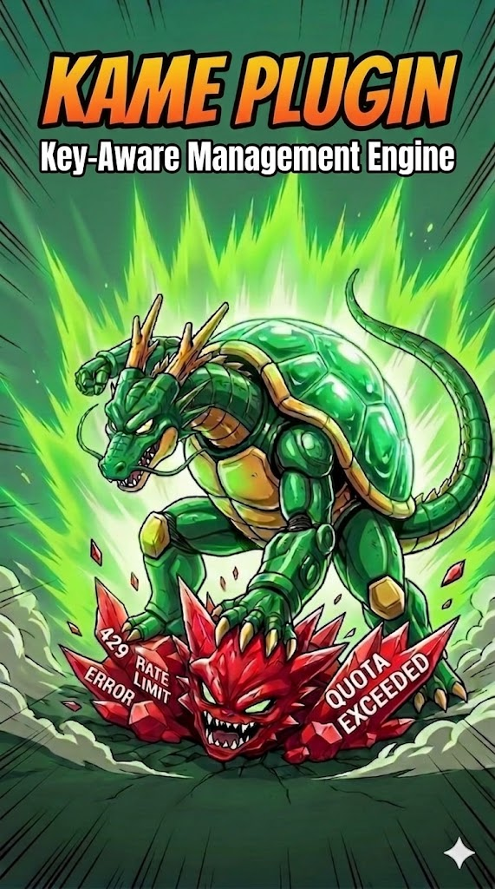
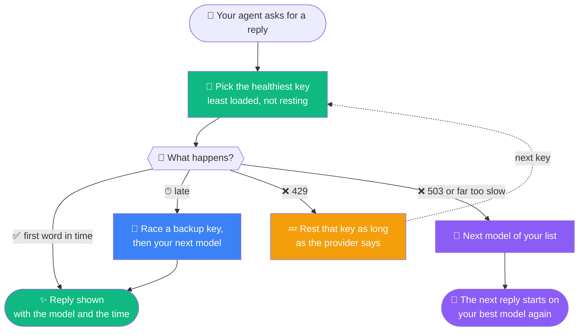

<div align="center">



# 🐢⚡ KAME — the best free API key rotation for AI agents

### Join the quota of many API keys, projects and accounts into one — and never let a 429 stop your agent again.

[](https://github.com/Kame696/kame-api-rotation-for-agent-zero)
[](https://github.com/Kame696/kame-api-rotation-for-hermes)
[](#-pick-your-agent)
[](#-faq)
[](#-license)

**Free · MIT · no proxy · no account · no telemetry · works with any provider**

</div>

---

## 🤔 What is KAME, in 20 seconds?

You have several API keys — one Gemini free-tier key per Google project, keys on OpenRouter,
Groq, NVIDIA, Mistral, OpenAI, Anthropic… Your AI agent uses **one** of them. When it hits
`429 Too Many Requests`, `RESOURCE_EXHAUSTED`, a daily quota or an "overloaded" provider,
**your agent stops** — while every other key sits there unused.

**KAME turns all your keys and models into one big pool.** Your agent keeps working, faster,
on more quota than any single key has.

- 🔑 **Every key used** — the healthiest key for each call; a refused call moves to the next key at once.
- ➕ **Quotas add up** — 14 free Gemini projects = 14× the free quota, used as one.
- ⚡ **Speed first** — a slow reply is raced by a backup key, then by your next model; the first to answer wins.
- 🔀 **Smart model fallback** — your best model first on every reply; a busy, spent or slow one hands over in seconds.
- 🧠 **Reads every error, never guesses** — the provider's own retry time, per-minute vs daily quota, out of credit, revoked key. 82 providers learned from their own docs.
- 👀 **You see everything** — which model answered each reply and how long it took; a live panel of every key.

## ⚡ How fast is it?

Measured live, on the author's own Gemini free-tier keys, on a bad day:

| Situation | Before 1.8.2.8 | KAME 1.8.2.8 |
|---|---|---|
| Your main model is slow (2 minutes for one word) | 46–120 s per reply | **2.6 s median** |
| Your main model is "overloaded" (503) | stuck on it | next model answering at **8.3 s**, then at once |
| Your main model is out of quota | next model, or the turn ends | switched in **0.3 s** |
| Everything healthy | — | your main model, first word in 2–4 s |

## 🔬 How it works



## 🚪 Pick your agent

<table>
<tr>
<td width="50%" valign="top">

### 🅰️ Agent Zero

**[kame-api-rotation-for-agent-zero →](https://github.com/Kame696/kame-api-rotation-for-agent-zero)**

Open the **Plugin Hub** inside Agent Zero and search **KAME** — or unzip the
[latest release](https://github.com/Kame696/kame-api-rotation-for-agent-zero/releases/latest)
into `/a0/usr/plugins/`.

Then paste several keys, comma-separated, into a provider's API key field.

</td>
<td width="50%" valign="top">

### 🅷 Hermes Agent (Nous Research)

**[kame-api-rotation-for-hermes →](https://github.com/Kame696/kame-api-rotation-for-hermes)**

```bash
hermes plugins install Kame696/kame-api-rotation-for-hermes/hermes-kame-api-rotation
hermes plugins enable hermes-kame-api-rotation
```

Then `/kame-keys add gemini KEY1,KEY2,KEY3` in the chat. For every feature (live status
line, the "which model answered" notice), also install the bridge — see the
[release](https://github.com/Kame696/kame-api-rotation-for-hermes/releases/latest).

</td>
</tr>
</table>

Both ports ship **1.8.2.8** and share one set of rules.

## 🧩 What each port does

| | Agent Zero | Hermes |
|---|---|---|
| Healthiest key per call, next key at once on a failure | ✅ | ✅ |
| Provider's own retry timing; per-minute vs daily vs out of credit | ✅ | ✅ |
| 82 providers learned from their own documentation (774 error shapes) | ✅ | ✅ |
| Your fallback models as one pool, best model first on every reply | ✅ KAME's own list | ✅ Hermes' list |
| A late reply raced by the next model; the first to answer is shown | ✅ any provider | ✅ same provider |
| A busy or slow model skipped for a while, then tried first again | ✅ | ✅ |
| Backup key raced for a slow first word; keys asked together when quota runs dry | ✅ | ✅ |
| Continues an answer the provider cut mid-stream | ✅ | ✅ |
| Tells the agent whether retrying an error will help | ✅ | ✅ |
| Which model answered each reply, and how long it took | ✅ a line after the reply | ✅ a Desktop notice |
| Live panel: keys, rests, events, fallback list, settings | ✅ | ✅ |
| Key management in the chat (`/kame-keys`) | ✅ | ✅ |

## ❓ FAQ

**Is it really free?** Yes. MIT license, no account, no telemetry, nothing to upsell.

**How do I rotate Gemini API keys / combine Gemini free tier quotas?** Create one key per
Google Cloud project (quota is per project), paste them all, comma-separated. KAME uses them
as one pool and rests each key exactly as long as Google says.

**How do I fix `429 RESOURCE_EXHAUSTED` or "quota exceeded" in my agent?** Install KAME with
more than one key. A refused call moves to the next key at once, and the refused key comes
back by itself when its quota does.

**Can it fall back to another model automatically?** Yes — only to models *you* listed,
never after part of the reply is on screen, and every new reply starts on your best model
again.

**Which providers?** Any your agent speaks to: Gemini, OpenAI, Anthropic, OpenRouter, Groq,
Mistral, NVIDIA, DeepSeek, Cerebras, SambaNova, Cloudflare, local models and more. There is
no provider allowlist — decisions are made on the evidence in each response.

**Is it a proxy? Do my keys leave my machine?** No proxy. Keys never leave your machine and
never appear in a log, an event or a panel — only a short fingerprint.

**Does it burn my quota?** No. By default (*Balanced*) a backup request is sent only when a
reply is clearly slower than usual — about 10% extra requests.

## ⭐ Like it?

KAME is free, MIT, and built by one person against real quotas that really run out. A ⭐
on either port costs nothing and helps other people find it.

## 📜 License

MIT, both ports. See each repository's `LICENSE`. Release history:
[Agent Zero](https://github.com/Kame696/kame-api-rotation-for-agent-zero/blob/main/CHANGELOG.md) ·
[Hermes](https://github.com/Kame696/kame-api-rotation-for-hermes/blob/main/CHANGELOG.md)

<div align="center">

Built by [**KAME**](https://github.com/Kame696) · Discord `kame055856`

<sub>Free API key rotation · API key load balancing · LLM key rotation · Gemini API key
rotation · combine free tier quotas · 429 rate limit fix · RESOURCE_EXHAUSTED · automatic
model fallback · Agent Zero plugin · Hermes Agent plugin · multi-key LLM · AI agent
reliability</sub>

*Not affiliated with Agent Zero or Nous Research.*

</div>
